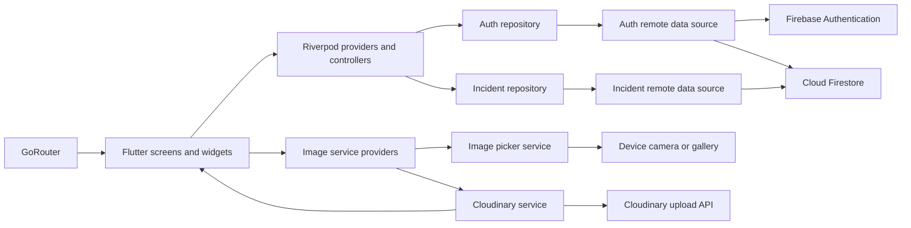
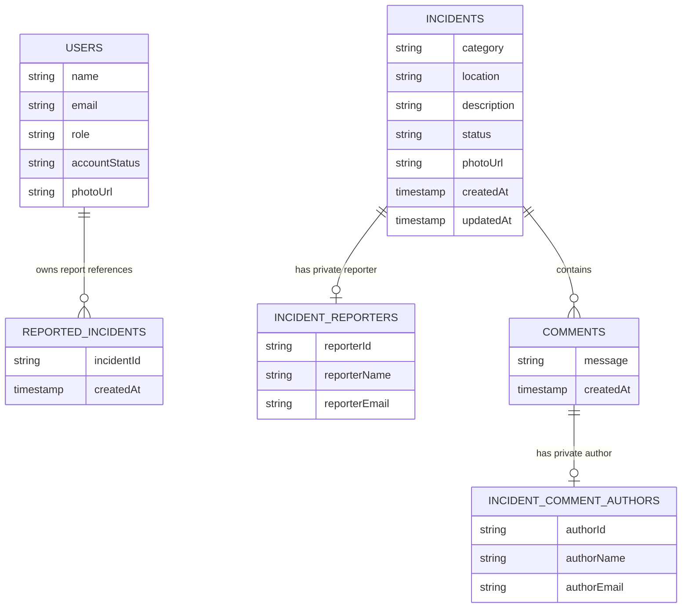

# CampusCare – Campus Incident Reporting Application

CampusCare is a Flutter application for reporting, tracking, and managing
incidents in a university community. Students can report campus problems and
follow their progress; approved staff can review reports, access reporter
information, and update incident statuses.

## Project overview

CampusCare addresses the difficulty of notifying the right campus staff about
maintenance, safety, and other campus problems and tracking whether they have
been addressed.

**Target users**

- **Students** who report issues and follow campus reports.
- **Approved campus staff** who review reports and coordinate their resolution.
- **Pending staff** who have registered with an ALU staff address but do not yet
  have staff permissions.

**Objectives**

- Provide a single place to submit and browse campus incident reports.
- Keep reporter and commenter identities private from students.
- Enforce account verification, roles, and status-based access in Firebase.
- Provide a development-only Firebase Emulator flow for staff demonstrations
  and authorization testing.

## Features

### Students

- Register with an `@alustudent.com` address and verify it by email.
- Sign in with email/password; Google sign-in is also present in the UI.
- Create incident reports with a category, location, description, and optional
  image.
- Browse and filter reports, view details, comment, and track status changes.
- See whether a report belongs to them without reading private reporter data.
- Cannot see private reporter identities or update incident statuses.

### Approved staff

- Sign in with an approved `@alustaff.com` account.
- See incident statistics and browse all campus reports.
- View private reporter information and commenter names.
- Update report status to one of the supported statuses.

### Pending staff

- Staff registration creates a `pending_staff` profile with `pending` account
  status after email verification.
- Pending staff are sent to a holding screen and cannot access staff features.
- The app does not currently provide a staff-approval screen. An already
  approved staff account can perform the permitted Firestore profile update;
  otherwise, approval must be handled through a trusted, authorized
  administrative process. After approval, the staff member signs in again.

### Incident statuses

The application and Firestore rules recognize `pending`, `reviewed`,
`in_progress`, and `resolved`. The current authorization rules restrict status
updates to approved staff and require a supported status, but do not enforce a
strict sequence between statuses.

## Technology stack

| Technology | Use in CampusCare |
|---|---|
| Flutter and Dart | Cross-platform application and UI. |
| Firebase Authentication | Email/password and Google sign-in, sessions, and email verification. |
| Cloud Firestore | User profiles, incident reports, comments, and private identity records. |
| Riverpod (`flutter_riverpod`) | Authentication state, repositories, and incident data providers. |
| GoRouter | Route configuration and authenticated account redirects. |
| Cloudinary | Incident and profile image uploads; images are stored as URLs in Firestore. |
| `image_picker` | Select an image from the gallery or take a photo. |
| `http` | Send Cloudinary multipart upload requests. |
| `path` | Validate image file extensions. |
| `google_sign_in` | Google account sign-in. |
| `integration_test` | Device/emulator integration tests. |

Firebase Storage is not used for image uploads. Although `storage.rules` is in
the repository, it is empty; this project does not configure or deploy Firebase
Storage rules.

## Prerequisites

Install the tools needed for your development platform:

- [Git](https://git-scm.com/downloads)
- [Flutter](https://docs.flutter.dev/get-started/install) with Dart SDK **3.13.2
  or later**, as required by `pubspec.yaml`
- [Android Studio](https://developer.android.com/studio) for the Android SDK and
  emulator, or a supported physical Android device
- [Firebase CLI](https://firebase.google.com/docs/cli) for emulator and rules
  commands. The npm installation method below also requires
  [Node.js](https://nodejs.org/)
- Access to the Firebase project `campuscare-61579`, or permission to create
  and configure a separate Firebase project
- A [Cloudinary](https://cloudinary.com/) account if you need to use image
  uploads with a different Cloudinary account

For iOS development, a Mac with [Xcode](https://developer.apple.com/xcode/) and
CocoaPods is required. Running the application on iOS is not supported from
Windows.

Verify the Flutter, Dart, Git, and Firebase CLI installations with:

```text
flutter --version
dart --version
git --version
firebase --version
flutter doctor
```

Resolve the issues reported by `flutter doctor` for the platform you intend to
build. An Android emulator or connected device should appear in `flutter
devices`.

## Repository

The repository URL was checked against the configured Git remote:

<https://github.com/IshimweJ-Ona/campus-care>

## Windows setup (PowerShell)

Run these commands in **PowerShell**, not Command Prompt.

### 1. Check Flutter and Dart

```powershell
flutter --version
dart --version
flutter doctor
```

Install or repair Flutter and the Android SDK if a command is not recognized or
`flutter doctor` reports a missing component. After changing `PATH`, open a new
PowerShell window.

### 2. Clone the repository

```powershell
git clone https://github.com/IshimweJ-Ona/campus-care.git campus_care_app
Set-Location campus_care_app
Get-Location
```

### 3. Install Dart and Flutter dependencies

```powershell
flutter pub get
```

This resolves the packages in `pubspec.yaml` and writes local package metadata.
It does not configure Firebase or Cloudinary.

### 4. Configure Firebase

The app's current Firebase project ID is `campuscare-61579`. The repository
contains `lib/firebase_options.dart` for Android and iOS, but the
Android-specific `android/app/google-services.json` is ignored by Git and must
be obtained or regenerated for a clean clone. The app does not support web,
Windows, or macOS Firebase initialization in its current generated options.

Install and authenticate the Firebase CLI if needed:

```powershell
npm install -g firebase-tools
firebase --version
firebase login
firebase projects:list
```

The commands below use the repository's configured project ID. If you use a
different Firebase project, replace `campuscare-61579` in the commands,
regenerate the FlutterFire configuration for that project, and update the
`$projectId` value in both emulator scripts under `scripts/` before running
them. The scripts only target local emulator endpoints.

Install and run FlutterFire CLI:

```powershell
dart pub global activate flutterfire_cli
dart pub global run flutterfire_cli:flutterfire --version
dart pub global run flutterfire_cli:flutterfire configure --project=campuscare-61579 --platforms=android,ios
```

Choose the Firebase project to which you have access. FlutterFire generates
`lib/firebase_options.dart` and the selected native Firebase configuration.
`lib/main.dart` initializes Firebase using
`DefaultFirebaseOptions.currentPlatform`.

If PowerShell cannot find `flutterfire`, use the `dart pub global run` form
above. Alternatively, add the Dart Pub global executable directory to your
user `PATH`:

```powershell
$dartPubBin = Join-Path $env:LOCALAPPDATA 'Pub\Cache\bin'
$userPath = [Environment]::GetEnvironmentVariable('Path', 'User')
$pathEntries = @($userPath -split ';' | Where-Object { $_ })
if ($pathEntries -notcontains $dartPubBin) {
    $pathEntries += $dartPubBin
    [Environment]::SetEnvironmentVariable('Path', ($pathEntries -join ';'), 'User')
}
$env:Path = "$env:Path;$dartPubBin"
flutterfire --version
```

Close and reopen PowerShell for the user `PATH` change to take effect in new
terminals.

In the Firebase Console:

1. Select the configured project (or create one and configure this app against
   it).
2. In **Authentication → Sign-in method**, enable Email/Password. Enable
   Google only if you intend to use Google sign-in; complete the platform OAuth
   configuration as well. Android Google sign-in also requires the appropriate
   SHA-1 fingerprint in Firebase project settings and a refreshed local
   `google-services.json`.
3. In **Firestore Database**, create the default `(default)` database in Native
   mode if it does not exist. Choose its region carefully; Firestore database
   location cannot be changed after creation.
4. Publish the repository's rules after reviewing them:

   ```powershell
   firebase deploy --only firestore:rules --project campuscare-61579
   ```

`firebase.json` points to `firestore.rules`. The checked-in
`firestore.indexes.json` is currently zero bytes, so it is not valid JSON. Make
it a valid empty index configuration before starting the Firebase emulators:

```powershell
[System.IO.File]::WriteAllText(
    (Join-Path (Get-Location) 'firestore.indexes.json'),
    '{"indexes":[],"fieldOverrides":[]}'
)
```

This declares no composite indexes; do not deploy indexes unless a future query
requires them. Firestore collections and documents are created by the app as
users report incidents and add comments; there is no seed-data step for
production.

The Firebase project configuration is not a service-account credential.
Never put Firebase Admin SDK keys or service-account JSON in Flutter, the
repository, or a client `.env` file.

### 5. Configure image uploads

Image uploads use Cloudinary, not Firebase Storage. The existing values are
defined in
[`lib/shared/services/cloudinary_service.dart`](lib/shared/services/cloudinary_service.dart):

- Cloud name: `vbzq5ssu`
- Incident upload preset: `campuscare_incidents`
- Profile upload preset: `campuscare_profiles`

The app sends unsigned uploads with the relevant upload preset. These values
are client-side configuration, not API secrets; the Cloudinary API secret is
not used by the app and must never be added to Flutter. To use your own
Cloudinary account:

1. Create the incident and profile upload presets in the Cloudinary Console.
   Configure each for unsigned image uploads and apply suitable limits and
   access restrictions in Cloudinary.
2. Update the cloud name and preset names in
   `lib/shared/services/cloudinary_service.dart` to match that account.
3. Do not commit any Cloudinary API secret or server credential.

The app accepts JPG/JPEG, PNG, and WEBP files up to **2 MiB**. The image picker
requests a maximum dimension of 1600 × 1600 pixels and image quality 80; the
2 MiB check is still applied after selection. Incident and profile images are
uploaded separately using their respective presets. Emulator tests do not
emulate Cloudinary.

### 6. Run on Android

Start an Android emulator from Android Studio or connect a device with USB
debugging enabled, then run:

```powershell
flutter devices
flutter run
```

If more than one device is available, Flutter will ask you to choose one. You
can also select a device using its ID from `flutter devices`:

```powershell
flutter run -d YOUR_DEVICE_ID
```

Replace `YOUR_DEVICE_ID` with the actual device ID.

## macOS setup

Run these commands in macOS Terminal. Install Flutter, Xcode, CocoaPods, Git,
Node.js, and Firebase CLI before building for iOS.

### 1. Check tools and clone

```bash
flutter --version
dart --version
flutter doctor
git --version

git clone https://github.com/IshimweJ-Ona/campus-care.git campus_care_app
cd campus_care_app
pwd
```

### 2. Install dependencies

```bash
flutter pub get
```

### 3. Configure Firebase

```bash
npm install -g firebase-tools
firebase --version
firebase login
firebase projects:list

dart pub global activate flutterfire_cli
dart pub global run flutterfire_cli:flutterfire --version
dart pub global run flutterfire_cli:flutterfire configure --project=campuscare-61579 --platforms=android,ios
```

The checked-in `firestore.indexes.json` is empty. Before using the Firebase
emulators, initialize it as a valid empty index configuration:

```bash
printf '{"indexes":[],"fieldOverrides":[]}\n' > firestore.indexes.json
```

If the `flutterfire` executable is not on `PATH`, the `dart pub global run`
commands work without adding it. To add the macOS Pub cache bin directory for
zsh:

```bash
echo 'export PATH="$PATH:$HOME/.pub-cache/bin"' >> ~/.zshrc
source ~/.zshrc
flutterfire --version
```

Configure Firebase Authentication and the default Firestore database in the
Firebase Console as described in [Windows setup](#4-configure-firebase).
Publish Firestore rules from the project root:

```bash
firebase deploy --only firestore:rules --project campuscare-61579
```

Use the Cloudinary Console and source configuration described in
[Configure image uploads](#5-configure-image-uploads).

### 4. iOS platform requirements

The Firebase Dart options include an iOS app configuration, but this repository
does not contain `ios/Runner/GoogleService-Info.plist`. Firebase initialization
uses the generated Dart options. The repository also has no
`NSCameraUsageDescription` or `NSPhotoLibraryUsageDescription` entries in
`ios/Runner/Info.plist`. Before using the camera or photo library on iOS, add
the corresponding usage descriptions to that plist; iOS requires these
permissions at runtime.

Google sign-in on iOS requires valid Firebase/Google OAuth client configuration
for the selected bundle ID (`com.example.campusCareApp`). This configuration
has not been verified from the repository alone. Follow the
[Firebase iOS Google sign-in setup](https://firebase.google.com/docs/auth/ios/google-signin)
and verify the URL scheme/client settings before relying on that sign-in
method.

### 5. Run on a device or simulator

Open an iOS simulator in Xcode or connect a device, then:

```bash
flutter devices
flutter run
```

If more than one device is available, Flutter will ask you to choose one. To
select a particular device:

```bash
flutter run -d YOUR_DEVICE_ID
```

Replace `YOUR_DEVICE_ID` with the actual device ID from `flutter devices`.

### 6. Run tests and the emulator workflow

The unit/widget and responsive tests run from macOS Terminal:

```bash
flutter analyze
flutter test
flutter test test/features/incidents/responsive_layout_test.dart
```

For emulator-backed integration tests, start Firebase emulators in one
terminal:

```bash
firebase emulators:start --project campuscare-61579 --only auth,firestore
```

The Staff Test initializer is a PowerShell script. If PowerShell 7 is installed
([installation instructions](https://learn.microsoft.com/powershell/scripting/install/installing-powershell-on-macos)),
run it from another terminal at the project root:

```bash
pwsh ./scripts/Initialize-StaffTest.ps1
```

Then set the password entered by the initializer for the integration test and
run it on the connected emulator/device:

```bash
printf 'Staff Test password: '
read -rs CAMPUSCARE_STAFF_TEST_PASSWORD
printf '\n'
export CAMPUSCARE_STAFF_TEST_PASSWORD
trap 'unset CAMPUSCARE_STAFF_TEST_PASSWORD' EXIT
flutter devices
flutter test integration_test/campuscare_integration_test.dart \
  --dart-define=USE_FIREBASE_EMULATORS=true
```

Run with one Android emulator/device connected. If multiple devices are
connected, add `-d YOUR_DEVICE_ID` using the output from `flutter devices`.
The direct rule-check script can also be run with
`pwsh ./scripts/Test-StaffTestAccess.ps1`. Stop Firebase emulators with
**Ctrl+C** in their terminal.

## Project structure

The following is the source and test structure relevant to development (build
outputs, generated plugin files, and IDE metadata are omitted):

```text
.
├── android/                         # Android Gradle project and app host
├── assets/                          # Project assets
├── integration_test/
│   └── campuscare_integration_test.dart
├── ios/                             # iOS Xcode project and app host
├── lib/
│   ├── app.dart                     # MaterialApp.router root
│   ├── main.dart                    # Firebase initialization and app startup
│   ├── firebase_options.dart        # FlutterFire platform options
│   ├── core/
│   │   ├── constants/
│   │   ├── routing/                 # GoRouter routes and route names
│   │   ├── themes/
│   │   └── utils/                   # Validation, errors, emulator gate
│   ├── features/
│   │   ├── auth/
│   │   │   ├── data/                # Auth Firebase data source/repository
│   │   │   ├── domain/              # AppUser and auth contract
│   │   │   └── presentation/        # Providers, screens, widgets
│   │   ├── home/presentation/
│   │   ├── incidents/
│   │   │   ├── data/                # Firestore data source/repository
│   │   │   ├── domain/              # Incident entities/repository contract
│   │   │   └── presentation/        # Providers, screens, widgets
│   │   ├── profile/presentation/
│   │   ├── splash/presentation/
│   │   └── staff/presentation/
│   └── shared/
│       ├── services/                # Cloudinary and image picker
│       └── widgets/                 # Reusable UI
├── scripts/                         # Development-only staff emulator scripts
├── test/
│   ├── core/
│   ├── features/
│   └── helpers/                     # Fakes and widget test setup
├── firebase.json
├── firestore.indexes.json
├── firestore.rules
├── pubspec.yaml
└── storage.rules
```

The feature folders separate the Firebase/data layer, domain entities and
contracts, and presentation layer. The project does not use a top-level
`models/` folder; its domain data types are in `domain/entities/`.

## Application architecture

### State management

Riverpod providers supply authentication and incident repositories and expose
asynchronous state to screens. Authentication actions are managed by the
authentication controller. Incident providers expose Firestore streams for
incident lists and comments and futures for incident details and reporter
information.

### Navigation

`lib/core/routing/app_router.dart` configures GoRouter. Main routes include
`/splash`, `/register`, `/login`, `/verify-email`, `/pending-staff`,
`/forgot-password`, `/home`, `/profile`, `/incidents`,
`/incidents/create`, and `/incidents/:incidentId`. Redirects check for a signed
in user, a verified email, and the user's role and account status.

The staff dashboard is the home screen with staff statistics enabled for an
approved staff user. The shared `/incidents` and incident-detail routes provide
report browsing and status controls according to the signed-in user's role.
There are additional screens under `features/staff/presentation`, but the
current GoRouter configuration does not expose them as separate routes.

### Authentication and account access

Firebase Authentication supports email/password registration and sign-in, email
verification, password reset, and Google sign-in. Registration accepts only
the role/domain pair:

- Student: `@alustudent.com`
- Staff: `@alustaff.com`

The email must be verified before an active user profile is created/accessed.
Students receive `role: student` and `accountStatus: active`. Staff
registrations receive `role: pending_staff` and `accountStatus: pending` and
must be approved before using staff functionality.

### Data access and persistence

Presentation widgets use Riverpod providers and repository contracts.
Repositories map Firestore maps and timestamps to domain entities. Remote data
sources perform Firebase Authentication and Firestore operations. Cloudinary
uploads are handled by a shared service used by incident and profile screens.



## Firestore data model

The app uses the default Firestore database. Documents are created on demand;
collections do not need to be manually pre-populated for a new project.

| Collection/path | Purpose and important fields |
|---|---|
| `users/{userId}` | User profile: `name`, `email`, `role`, `accountStatus`, optional `photoUrl`, and `createdAt`. |
| `incidents/{incidentId}` | Public report: `category`, `location`, `description`, `status`, optional `photoUrl`, `createdAt`, and `updatedAt`. |
| `incidents/{incidentId}/comments/{commentId}` | Comment: `incidentId`, `message`, and `createdAt`. Author identity is not included in the public comment document. |
| `incident_reporters/{incidentId}` | Private report identity: `incidentId`, `reporterId`, `reporterName`, `reporterEmail`, and `createdAt`. Only approved staff can read it. |
| `incident_comment_authors/{commentId}` | Private commenter identity: `commentId`, `incidentId`, `authorId`, `authorName`, `authorEmail`, and `createdAt`. Only approved staff can read it. |
| `users/{userId}/reported_incidents/{incidentId}` | Private reference with `incidentId` and `createdAt`, allowing a student to identify their own reports without reading reporter records. |

The incident is associated with its reporter and the student's private
`reported_incidents` reference using a Firestore batch. A comment and its
private author record are also written together. Student clients can read
public incident and comment data but cannot read private reporter or commenter
identity documents. Approved staff can read those private documents.



## Security and access control

The app applies authentication and account checks in the UI/data layer, while
`firestore.rules` independently enforces Firebase authorization:

- Requests require a signed-in user whose Firebase email is verified and
  matches one of the two ALU domains.
- Active students can create reports and read campus incidents/comments.
- Pending staff do not qualify as active students or approved staff and cannot
  read protected incident data.
- Approved staff are profiles with `role: staff` and `accountStatus: active`.
  They can read all incident reports, private reporter/commenter identities,
  and update valid incident statuses.
- Students cannot update incident status or read private reporter/commenter
  records.
- Unmatched Firestore paths are denied by the catch-all rule.

Hiding a control in the UI is not an authorization boundary; the deployed
Firestore rules must be kept in place. Review `firestore.rules` before
publishing any change.

### Development Staff Test account

The account `staff.test@campuscare.dev` exists only as a **local development
emulator** test account. It is not accepted by ordinary registration and is not
a production account.

- The Flutter exception is compiled only when running a debug build with
  `USE_FIREBASE_EMULATORS=true`.
- Release builds reject that emulator flag.
- `scripts/Initialize-StaffTest.ps1` creates or signs into the account on the
  local Auth Emulator, marks it verified, creates its active staff profile in
  the local Firestore Emulator, and loads a temporary exact-address rules
  variant into that emulator.
- The script prompts for a password and does not save it. Do not treat the
  emulator's verified flag as proof of a real-world identity.
- The temporary rule is loaded only into the emulator at `127.0.0.1:8080`;
  production `firestore.rules` continues to accept only verified ALU domains.

See [Firebase Emulator workflow](#firebase-emulator-workflow) for setup and
login instructions.

## Testing

The repository has unit tests, mocked widget tests, a responsive layout matrix,
one emulator-backed integration test, and PowerShell rules checks.

### Static analysis

```powershell
flutter analyze
```

### Unit and widget tests

```powershell
flutter test
```

Most widget tests use repository fakes and do not require live Firebase.
Unit/widget coverage includes email and password validation, account roles,
incident model and validation behavior, auth screens, incident creation and
details, staff controls, error handling, and UI loading/empty/error states.

### Responsiveness tests

The responsive widget matrix runs seven screens at mobile and tablet sizes in
portrait and landscape:

```powershell
flutter test test\features\incidents\responsive_layout_test.dart
```

The configured sizes include approximately 320×568, 390×844, 430×932, and
800×1280, plus their landscape orientations.

### Firebase Emulator workflow

Install Node.js and Firebase CLI, then start the Auth and Firestore emulators
from the project root:

```powershell
firebase emulators:start --project campuscare-61579 --only auth,firestore
```

The Auth emulator uses port `9099`, Firestore uses `8080`, and the Emulator UI
is configured for port `4000`. Keep that terminal running. In a second
PowerShell window, initialize Staff Test:

```powershell
Set-Location 'C:\path\to\campus_care_app'
.\scripts\Initialize-StaffTest.ps1
```

Replace the example path with the folder where you cloned the repository.
Choose and remember the password when prompted. To demonstrate the staff
workflow, run the debug app against emulators:

```powershell
flutter devices
flutter run --dart-define=USE_FIREBASE_EMULATORS=true
```

With one connected device, Flutter can select it automatically. If you connect
more than one, add `-d YOUR_DEVICE_ID` using an ID printed by `flutter
devices`. For a physical Android device, use the computer's LAN IP as the
emulator host:

```powershell
flutter run --dart-define=USE_FIREBASE_EMULATORS=true `
  --dart-define=FIREBASE_EMULATOR_HOST=192.168.1.10
```

Replace the example address with the development computer's reachable LAN IP.
The Android emulator default is `10.0.2.2`; iOS Simulator defaults to
`127.0.0.1`.

Log in with `staff.test@campuscare.dev` and the password entered in the
initializer. The staff home screen shows incident statistics. Open **View
Campus Reports**, choose a report to view reporter information, and update its
status.

Run the integration test with one Android emulator/device connected. The test
creates unique student and pending-staff accounts, exercises verification,
incident and comment persistence, checks private-data and status rules, then
uses Staff Test for approved-staff operations. It requires the Staff Test
password as a process environment variable:

```powershell
$secure = Read-Host 'Staff Test password' -AsSecureString
$pointer = [Runtime.InteropServices.Marshal]::SecureStringToBSTR($secure)
try {
    $env:CAMPUSCARE_STAFF_TEST_PASSWORD = [Runtime.InteropServices.Marshal]::PtrToStringBSTR($pointer)
    flutter test integration_test\campuscare_integration_test.dart `
      --dart-define=USE_FIREBASE_EMULATORS=true
}
finally {
    Remove-Item Env:\CAMPUSCARE_STAFF_TEST_PASSWORD -ErrorAction SilentlyContinue
    [Runtime.InteropServices.Marshal]::ZeroFreeBSTR($pointer)
}
```

If multiple devices are connected, add `-d YOUR_DEVICE_ID` using an ID from
`flutter devices`.

Run additional direct authorization checks after initializing the emulator
account and temporary rules:

```powershell
.\scripts\Test-StaffTestAccess.ps1
```

This script prompts for Staff Test and a local student account's passwords. It
tests staff report/reporter reads and status updates, student report reads,
and denials for student access to private reporter information and status
updates. Emulator test data is local; these scripts are not production
administration tools.

Stop Firebase emulators with **Ctrl+C** in the terminal running them.

> The integration test exercises auth/data-source and Firestore workflows; it
> does not automate the full GoRouter UI. The integration workflow uses a
> fixture Cloudinary URL; Cloudinary uploads themselves are not emulated.
> Integration tests and PowerShell emulator scripts must be run locally before
> reporting their results; no test result is implied by these instructions.

## Application workflows

### Student report

1. Register with a name, password, and `@alustudent.com` email.
2. Follow the Firebase email verification link, then return to the app and
   complete verification/sign in.
3. Open **Report an Incident**, choose a category, enter a location and
   description, and optionally select or take a photo.
4. Submit the report. The app uploads a selected photo to Cloudinary and saves
   its URL with the incident. Firestore creates the public incident and
   private reporter/reference records together.
5. Browse or filter campus reports, open one to read its details, and add a
   comment. The list shows status updates as Firestore data changes.

### Staff review

1. Use an approved `@alustaff.com` account and verify its email.
2. If the account is still pending, wait for a trusted approver to update the
   Firestore profile; the app currently has no approval-management screen.
3. Sign in again after approval to access the staff dashboard and statistics.
4. Open campus reports to see reporter details and update a report's status.

### Profile and sign-out

The profile screen supports account profile actions, including sign-out. Image
selection and upload are subject to the Cloudinary configuration and the
platform's camera/photo-library permissions.

## Screenshots

No product screenshots are currently maintained in the repository. Capture
screenshots from a local emulator or device and add them here when available:

- `[Screenshot placeholder: Login screen]`
- `[Screenshot placeholder: Student home dashboard]`
- `[Screenshot placeholder: Create incident form]`
- `[Screenshot placeholder: Incident details and comments]`
- `[Screenshot placeholder: Approved staff dashboard and status update]`

Do not include real reporter names, email addresses, passwords, or other
personal data in screenshots.

## Assignment and technical report

This README explains how to set up and understand the software. It does not
replace a separate academic technical report. The report should provide the
full discussion and evidence for:

- Problem statement, objectives, target users, and requirements.
- System architecture and feature-based layered design.
- Firestore data model, relationships, and authorization.
- Authentication, email verification, and role approval.
- Riverpod state management, GoRouter navigation, and UI/UX decisions.
- Unit, widget, emulator integration, security, and responsiveness testing.
- Implementation challenges, lessons learned, known limitations, and future
  improvements.
- Diagrams, properly anonymized screenshots, references, and the demonstration
  video.

## Troubleshooting

| Problem | Likely cause and next step |
|---|---|
| `flutter` or `dart` is not recognized | Install Flutter, add its `bin` folder to `PATH`, reopen the shell, and run `flutter doctor`. |
| Android SDK or licenses are missing | Install Android SDK/platform tools in Android Studio; review `flutter doctor --android-licenses` and accept the licenses you need. |
| No device is available | Start an Android emulator or connect/unlock a device with debugging enabled; check `flutter devices`. |
| `flutterfire` is not found | Run `dart pub global run flutterfire_cli:flutterfire ...`, or add `%LOCALAPPDATA%\Pub\Cache\bin` (Windows) / `$HOME/.pub-cache/bin` (macOS) to `PATH`. |
| Firebase initialization fails on Android | Run FlutterFire configure for the right project and confirm `android/app/google-services.json` exists and corresponds to this app's Android application ID. |
| Wrong Firebase project or permission denied | Check the selected project ID, sign-in provider settings, verified ALU email, profile role/status, and deployed `firestore.rules`. Do not loosen production rules to silence a denial. |
| Email verification does not arrive | Check the Firebase Auth email/password provider and the recipient's spam folder; for local tests use the Auth Emulator's verification flow. |
| ALU email is rejected | Registration accepts only `@alustudent.com` for students and `@alustaff.com` for staff. Staff Test is a debug emulator login only, not a registration domain. |
| Cloudinary upload fails | Verify network access, cloud name, preset name, unsigned-upload configuration, file extension, and the 2 MiB app limit. Cloudinary is a live external service even while Firebase emulators are running. |
| Firebase CLI cannot authenticate | Run `firebase login`, then `firebase projects:list`, and confirm access to the project. |
| Emulator integration test cannot connect | Start Auth and Firestore emulators first, initialize Staff Test, pass `--dart-define=USE_FIREBASE_EMULATORS=true`, and use a reachable emulator host/device ID. |
| Package resolution fails | Check network access and the Dart SDK constraint in `pubspec.yaml`, then retry `flutter pub get`. Do not delete the lockfile as a first troubleshooting step. |
| iOS camera/gallery access fails | Add `NSCameraUsageDescription` and `NSPhotoLibraryUsageDescription` to `ios/Runner/Info.plist`; these entries are currently absent. |
| iOS Google sign-in fails | Complete the Firebase Google provider setup for the iOS bundle ID and verify the OAuth client and URL scheme; this repository's iOS native Google configuration is not verified. |

For platform-specific differences, use PowerShell commands in the Windows
sections and Terminal commands in the macOS section. Firebase CLI and Flutter
commands are otherwise the same when invoked from the respective shells.

## Contributing

Contributions and issue reports should use the
[CampusCare GitHub repository](https://github.com/IshimweJ-Ona/campus-care).
Before submitting a change:

1. Create a focused branch:

   ```powershell
   git switch -c feature/short-description
   ```

2. Make the smallest change that addresses the issue.
3. Run relevant tests and `flutter analyze`.
4. Open a pull request describing the change, validation performed, and any
   Firebase or Cloudinary setup required.

Use GitHub Issues to report reproducible bugs, including platform, Flutter/Dart
versions, steps to reproduce, and sanitized error output. Never attach
credentials, service-account files, or private reporter data.

The repository owner is `IshimweJ-Ona`; no separate author or team roster is
specified in the repository. Add verified assignment/team details in the
technical report rather than guessing them here.

## Known limitations and configuration gaps

- No in-app staff approval-management UI is implemented.
- `firestore.indexes.json` and `storage.rules` are empty; Storage is not used.
- Cloudinary uploads depend on configured unsigned presets and a live network
  service; uploads are not emulator-backed.
- The iOS plist lacks camera/photo-library usage descriptions, and native
  Google sign-in configuration needs validation before those iOS flows are
  relied on.
- `lib/firebase_options.dart` configures Android and iOS only. Web, Windows,
  and macOS are not configured as Firebase application targets.
- The integration test covers backend/auth workflows on an emulator/device,
  not a complete UI-driven end-to-end journey.
- This repository contains no GitHub Actions workflow under `.github/`.
- The Android application ID and iOS bundle ID are currently example-style
  `com.example...` identifiers; configure production identifiers and signing
  before release.
